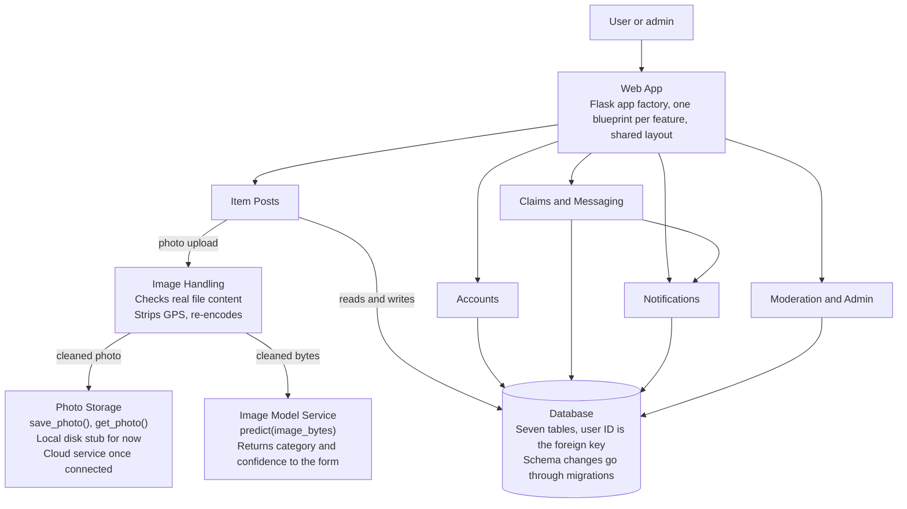

# FoundIt Software Architecture Document, Sprint 2

Nov 8, 2026 · Jaycob Campos

FoundIt is a lost and found web app. Users post items, search listings, submit ownership claims, and message each other privately. This document covers the architecture. That means the components, how data moves between them, the data model, and how we secure, host, and test the app. Our team plan is in [Sprint Plan](sprint-plan.md). The Sprint 2 acceptance criteria are in [Sprint 2 Requirements](sprint-2-requirements.md).

## Project information

**Group 14:** Jaycob Campos, Lydia Peng, Khang Phan, Andrew Kruckemyer, Jonathan Kazmaier, and Nick Heyer

**Requirements and reference stories spreadsheet:** [Requirements Stack](https://kansasmy.sharepoint.com/:x:/g/personal/j010c700_home_ku_edu/IQA6iV7TvNW0SpHeWSRoN92wAX_zEpB8Fkl33sK2_t23LVU?e=42mezI)

## System overview

FoundIt is one Flask web app hosted online. It talks to a relational database, a cloud photo storage service, and an image model. The model is fine-tuned from a pretrained backbone. Every request comes in through the Web App, so the Web App calls the other components.

We laid out the code so every new feature plugs in without reworking what exists:

- **App factory and blueprints.** Each component is its own blueprint, so a new feature is a new module and not an edit to a shared file.
- **Full schema up front.** All seven Data Model tables exist from the start, so new features add routes, not tables.
- **Migrations.** Every schema change goes through a migration, so the hosted database never drifts from the code.
- **Interfaces between parts.** We reach photo storage only through `save_photo()` and `get_photo()`, and the model only through `predict(image_bytes)`, which returns a category and a confidence. Each side can change without breaking the other.

### Components

| Component | Responsibility |
| --- | --- |
| Web App | Flask routes, pages, shared layout that works on phones, 404 page |
| Accounts | Register, log in, log out, roles, password hashing |
| Item Posts | Create, view, browse, edit, delete, search, filter, sort, mark resolved |
| Image Handling | Check real file content, strip GPS, re-encode with orientation kept |
| Photo Storage | `save_photo()` and `get_photo()`. A local disk stub stands in until the cloud service is connected |
| Image Model Service | `predict(image_bytes)` returns a category and a confidence. Loads once at startup |
| Claims | Ownership questions, claim form, approve or deny, claim status |
| Messaging | Private messages and inbox conversations |
| Notifications | Unread alerts for claims and messages, notification inbox |
| Moderation and Admin | Reports, admin review page, bans, auto-close old posts, rate limiting |
| Database | Stores all seven tables, user ID as a foreign key |

## Component diagram

Every feature blueprint reads and writes the database. An uploaded photo always passes through Image Handling first, so storage and the model only ever see the cleaned copy. Claims and Messaging creates notifications, and the model's guess returns to the post form through Item Posts.

## Data flow

The app has three main flows. Only posting with a photo and photo search touch the image model. Keyword search, filters, and sorting are plain database queries.

### Flow 1: Posting an item

1. The user fills in the post form and attaches a photo.
2. Image Handling checks the real file content. If it is not an image, we reject it with a clear error and save nothing.
3. Image Handling strips GPS metadata and re-encodes the photo with its orientation kept.
4. The cleaned photo goes to `save_photo()`, which stores it and returns a storage reference.
5. The same cleaned bytes go to `predict()`. The model never sees the original upload.
6. If the confidence is at or above the threshold, the guessed category fills the category field. Otherwise the field stays blank.
7. The poster confirms or changes the category and submits. The guess never blocks posting.
8. The Item row and its Photo row are saved, linked to the poster.

### Flow 2: Claims and messages

1. A user who thinks an item is theirs answers the ownership questions the poster set.
2. A Claim row is saved with status pending, and the poster gets an unread notification.
3. The poster reviews the answers and approves or denies the claim.
4. The claim status is updated, and the claimant gets an unread notification with the result.
5. Either user can send a private message about the item. The Message row is saved, the recipient gets a notification, and the message shows in both inboxes grouped as a conversation.

### Flow 3: Search

- **Keywords, filters, and sorting:** the Web App builds one database query from the criteria and shows the results. Each result opens its detail page.
- **Photo search:** the user uploads a photo, it goes through Image Handling, and `predict()` returns a category. The Web App shows posted items in that category.

## Data model

Each class is one table, and all seven exist from the start. A row that points to a user who does not exist is rejected.

| Table | Fields | Links |
| --- | --- | --- |
| User | `user_id`, `username`, `email`, `password_hash`, `role`, `banned` | Posts many Items, sends and receives Messages, submits Claims, files Reports |
| Item | `item_id`, `poster_id`, `title`, `description`, `category`, `date`, `location`, `status`, `resolved`, `ownership_questions` | One poster, one Photo, many Claims, many Messages |
| Photo | `photo_id`, `item_id`, `storage_reference` | One Item |
| Claim | `claim_id`, `item_id`, `claimant_id`, `ownership_answers`, `status` | One Item, one claimant, triggers Notifications |
| Message | `message_id`, `sender_id`, `recipient_id`, `item_id`, `text`, `sent_at` | Two Users, one Item |
| Notification | `notification_id`, `user_id`, `claim_id`, `type`, `read` | One User, at most one Claim |
| Report | `report_id`, `reporter_id`, `target_item_id`, `target_user_id`, `reviewer_id`, `reason`, `status` | Filed by one User against an Item or a User, reviewed by an admin |

Rules the code enforces:

- `username` and `email` are unique.
- Item `status` is lost or found. Claim `status` is pending, approved, or denied.
- `ownership_questions` and `ownership_answers` are JSON.
- Where a claim's supporting details go is TBD before Req 32c. The choice is inside `ownership_answers` or a new field.
- A message notification has no `claim_id`, so that column allows empty values.

## Security, hosting, and testing

Security works in layers: accounts, secrets, uploads, privacy, permissions, and spam limits.

### Security

| Control | How it works | Req |
| --- | --- | --- |
| Password hashing | Salted hashes. Two users with the same password get different hashes | 22 |
| Secrets | Secret key, database credentials, and cloud storage credentials come from environment variables. `.env` is gitignored | 23 |
| Image safety | Real file content is checked, not only the extension. GPS is stripped before storage and before the model | 6, 25 |
| Privacy | Public pages show only a username. Email shows only on the owner's account page | 24 |
| Ownership checks | Every edit, delete, and resolve route checks that the signed-in user owns the post | 17, 19 |
| Rate limiting | A global request limit plus a posting limit, with an error page | 29 |
| Moderation | Users report posts and users. Admins review reports, delete posts, and ban users. Admin routes check the role | 26, 27, 30, 35 |

### Hosting

The app runs at a public HTTPS URL, and accounts stay put after restarts and redeploys. The hosting provider and cloud storage provider are TBD. Database changes reach production through migrations. Main pages work on phone screens without horizontal scrolling.

### Testing

All tests use pytest and a separate test database. We replace the cloud client and the model with fakes, so the app tests run offline. We check the model itself separately on held-out photos.

| Area | Req |
| --- | --- |
| Accounts | 40 |
| Posting and search | 42 |
| Claim flow end to end, messaging, edit and delete, spam resistance | 45 |
| Admin permissions | 36 |
| Category guess on held-out photos | 13 |
| Photo search on sample data | 14 |

The README covers purpose, setup, environment variables, how to run the app, and how to run the tests. It is Req 37.

## Open items

These design questions are still TBD. Who decides each one, and by when, is in the [Sprint Plan](sprint-plan.md).

| Question | Affects |
| --- | --- |
| Hosting provider and cloud storage provider | Hosting, Photo Storage |
| Category list | Item category field, Image Model Service |
| Image formats accepted | Image Handling |
| Where a claim's supporting details go, and the claim rules | Claim table, Claims |
| Where the model weights file lives | Image Model Service |
| Confidence threshold for leaving the category blank | Flow 1, post form |
| Which filters ship | Search |
| Rate limit values | Rate limiting |
| Cutoff age for closing old posts, and the new archived field | Item table, Moderation |
| Where notification creation is wired | Notifications |
